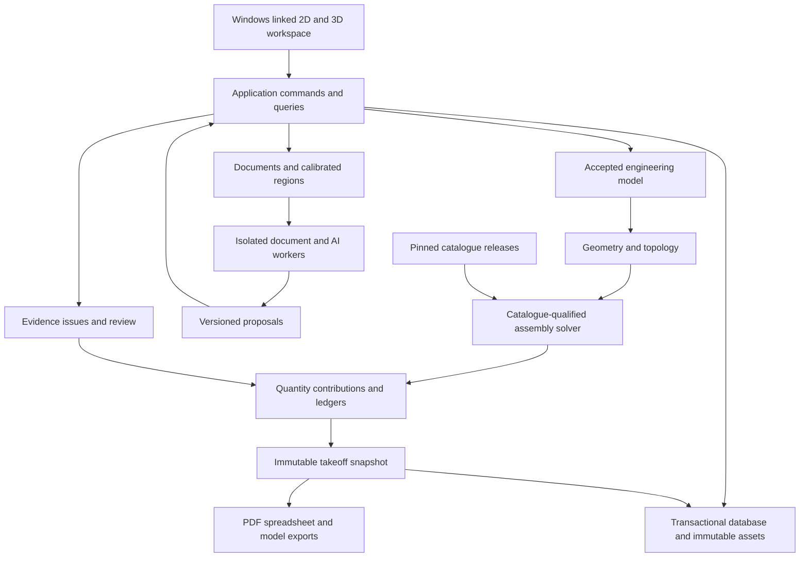

# Architecture and ownership

Status: recommended design, 2026-11-24. See [decisions](11-decisions.md) for alternatives and reopen triggers.

## Structure

Use a modular desktop application with isolated document/AI workers. Keep the deterministic core in-process initially. Do not add distributed services before a measured need.

## Modules and public internal interfaces

| Module | API responsibilities | Writes |
|---|---|---|
| Application | `ExecuteCommand`, `QueryProject`, `StartJob` | Transaction boundary, revision, event/outbox |
| Documents | `StageUpload`, `ImportRevision`, `SetCalibration`, `GetSourceRegion` | Immutable sources, transforms, calibration records |
| Geometry | `Length`, `ClosestPoints`, `Transform`, `ValidateGeometry` | None; pure functions |
| Topology | `FindCandidates`, `ValidateConnection`, `BuildNetwork` | Through application commands only |
| Catalogue | `GetPinnedPart`, `ValidateEntry`, `ProposeRelease` | Staging and qualified releases |
| Assemblies | `ResolveCandidates`, `CheckFit`, `ExpandMaterial` | Proposed assembly result, accepted via command |
| Quantities | `Calculate`, `Aggregate`, `CompareSnapshots` | Versioned derived results through coordinator |
| Evidence/review | `AttachClaim`, `ReviewProperty`, `InvalidateDependents` | Claims, review decisions, issues |
| Jobs | `Enqueue`, `GetStatus`, `Cancel` | Job records and output handles |
| Reporting | `FreezeSnapshot`, `ExportSnapshot` | Immutable snapshots/artifacts |

Interfaces exchange DTOs, stable IDs and immutable input views, not UI controls or mutable SDK objects. Cancellation is explicit on expensive operations. Geometry cannot silently access the current project or a live catalogue.

## Four graphs

1. Physical graph: components, ports, joints and internal component connectivity; loops allowed.
2. Hydraulic graph: optional analysis projection with mapping to physical IDs; loops allowed.
3. Evidence graph: observations, competing claims, decisions, actors and derivations.
4. Calculation DAG: inputs to derived values and snapshots; cycles are an error.

W3C provenance concepts inform evidence modeling [R06](10-research-sources.md); the specific four-graph decomposition is our design recommendation.

## Write and failure paths

Validate command -> check expected revision -> resolve referenced assets/catalogue releases -> apply invariant checks -> commit all domain changes and audit events atomically -> invalidate dependent results -> publish outbox/job work. A crash cannot leave accepted new assemblies with apparently current old quantities.

Workers read frozen inputs and write proposals/artifacts only. Completion on an older model is marked stale and does not overwrite current state. Reports use frozen snapshots, never a live model during rendering.

## Deployment and security boundaries

Local manual modeling, calculation and reporting must work offline. Parse untrusted drawings in a bounded worker process. If PDFium is selected, obey its thread-safety contract: serialize API calls per worker/library instance rather than assuming concurrent calls are safe [R15](10-research-sources.md).

Local storage follows OS permissions. Optional external AI requires explicit project data policy and OS-managed secret storage. Avoid source text in routine logs. If the HTTP adapter is enabled, bind to loopback only, use a random launch token, verify Host/Origin where applicable, disallow wildcard browser origins, reject arbitrary filesystem paths/URLs and enforce project-scoped authorization. Loopback alone is not authentication.

## Proposed repository layout

`src/Core` (units, geometry, topology, assembly, quantities); `src/Application`; `src/Infrastructure`; `src/Desktop`; `src/Workers`; optional `src/HttpAdapter`; `contracts`; `catalogues`; `tests/Reference`, `tests/Integration`, `tests/Recovery`; `docs/decisions`.

These application directories are proposed; this kit does not create a compiled application. Renderer, PDF engine, project capacities, latency and recovery targets require selection/benchmarking.
